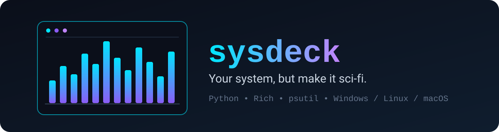

<p align="center">
  
</p>

# sysdeck 🛰️

**Your system, but make it sci-fi.** One command and your terminal turns into a live control-room dashboard. 😎

No setup, no config files, no accounts. Just run it.

## ✨ What you get

- 🧠 **CPU**: total usage, a live history graph and a bar for every core
- 💾 **Memory**: RAM, swap and (on laptops) battery level
- 💽 **Disks**: usage per drive plus live read/write speed
- 🌐 **Network**: download and upload speed with sparkline graphs
- 🔥 **Top processes**: who is eating your CPU right now
- 🎨 **3 themes**: `cyber`, `matrix` and `amber`
- 🪟🐧🍎 Works on **Windows, Linux and macOS**

## 👀 Preview

> Sample data, your own numbers will be live and colorful. 🌈

```text
╭──────────────────────────────────────────────────────────────────────────────────────────────────╮
│ ◢ SYSDECK ◣  cyberloop-pc  •  Windows 11  •  up 2d 05h 21m  •  20:19:51                          │
╰──────────────────────────────────────────────────────────────────────────────────────────────────╯
╭───────────────────── CPU ──────────────────────╮╭──────────────── MEMORY & POWER ────────────────╮
│ TOTAL ██████████████░░░░░░░░░░░░░░░░░░  43.5%  ││ RAM  ███████████████████░░░░░░░░░░░░░░  58.7%  │
│ ▃▃▃▄▄▄▅▅▆▅▅▅▅▅▄▄▄▃▃▃▄▄▅▅▅▅▅▅▅▅▄▄▃▃▄▄▅▄▅▅▅▅▅▅▅▅ ││      9.4 GB / 16.0 GB                          │
│  0 ███████░░░░  62.0%   1 ██░░░░░░░░░  18.0%   ││ SWAP █████░░░░░░░░░░░░░░░░░░░░░░░░░░░░  15.0%  │
│  2 ██████████░  91.0%   3 ████░░░░░░░  34.0%   ││ BATT █████████████████████████░░░░░░░░  76.0%  │
│  4 █░░░░░░░░░░  12.0%   5 ████████░░░  77.0%   ││      on battery                                │
│  6 █████░░░░░░  45.0%   7 █░░░░░░░░░░   9.0%   │╰────────────────────────────────────────────────╯
╰────────────────────────────────────────────────╯╭─────────────────── NETWORK ────────────────────╮
╭──────────────────── DISKS ─────────────────────╮│ DOWN 2.3 MB/s                                  │
│ C:\      ███████████████████░░░░░░░░░░  65.5%  ││ ▃▂▂█▁▂▁▁▁▃▁▂▂▃▁▂▂▃▃▃▄▂▂▃▃▁▁▁▁▂▂▂▁▂▂▂▃█▂▂▂▁▃▃▃▃ │
│          312.0 GB / 476.0 GB                   ││ UP   302.7 KB/s                                │
│ D:\      ███████░░░░░░░░░░░░░░░░░░░░░░  23.0%  ││ ▁▇▅▂▃▃▄▂▇█▄▄▂▂▃▃▇▂▁█▅▂▅▁▅█▇▆▃▄▂▆▅▆▃▃▇█▇▇▇▆▃▅▄▁ │
│          214.0 GB / 931.0 GB                   │╰────────────────────────────────────────────────╯
│ I/O  read 13.5 MB/s  write 3.6 MB/s            │
╰────────────────────────────────────────────────╯
╭───────────────────────────────────────── TOP PROCESSES ──────────────────────────────────────────╮
│      PID  NAME                                                                     CPU      MEM  │
│     4120  chrome.exe                                                             14.2%     6.1%  │
│     9876  python.exe                                                              9.8%     1.4%  │
│     2210  Code.exe                                                                6.3%     3.9%  │
│     1544  obs64.exe                                                               4.7%     2.2%  │
│      772  explorer.exe                                                            1.1%     0.8%  │
╰──────────────────────────────────────────────────────────────────────────────────────────────────╯
```

## 🚀 Install

**Option 1: install it like a normal command**
```bash
pip install git+https://github.com/CyberLoop-dev/sysdeck.git
sysdeck
```

**Option 2: just run the file**
```bash
git clone https://github.com/CyberLoop-dev/sysdeck.git
cd sysdeck
pip install -r requirements.txt
python sysdeck.py
```

You need Python 3.9 or newer. Press `Ctrl+C` to quit.

> 💡 For the best look on Windows, use **Windows Terminal** (not the old CMD window).

## 🎮 Options

| Option | Default | What it does |
|---|---|---|
| `--theme` | `cyber` | Colors: `cyber`, `matrix` or `amber` |
| `--interval` | `1` | Seconds between updates |
| `--procs` | `8` | How many top processes to show |
| `--once` | off | Print one frame and exit (nice for screenshots) |
| `--version` | | Show the version |

Examples:
```bash
sysdeck --theme matrix
sysdeck --interval 0.5 --procs 12
sysdeck --once
```

## ❓ FAQ

- **The boxes look broken.** Use Windows Terminal or any modern terminal with a Unicode font.
- **Why no temperatures?** Windows doesn't let Python read them in a standard way, so sysdeck skips what your system can't provide instead of crashing.
- **Why is a process lower than in Task Manager?** The CPU % is divided by your core count, the same way Task Manager does it.
- **Does it send anything online?** No. Everything stays on your computer.

## 🧪 Tests

```bash
python -m unittest discover tests
```

## 🛠️ Built with

[psutil](https://github.com/giampaolo/psutil) for the numbers and [Rich](https://github.com/Textualize/rich) for the looks. 💜

## 📄 License

MIT
